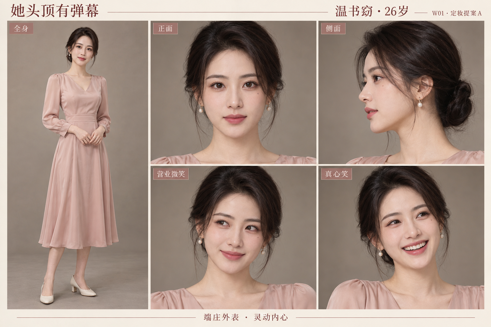
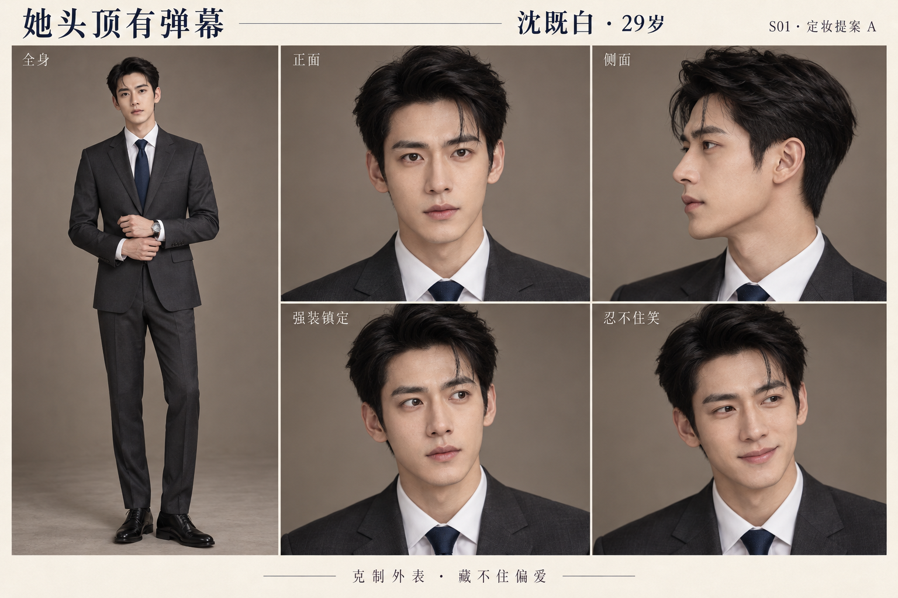
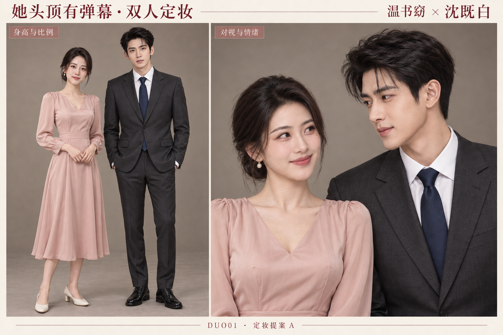

# 《她头顶有弹幕》男女主定妆与人物卡

定妆提案 A｜2026-10-14｜人物图像与制作任务单

依据：《她头顶有弹幕》第二稿 v2.1。制作顺序遵循已确认的“人物定妆与人物卡 → 第一集分镜与画面样片 → 配音试读与节奏校准”。

本轮已生成女主定妆卡、男主定妆卡和双人同框卡，共三张 1536×1024 的 PNG 原图。它们是一套原创虚构人物的静帧定妆提案，供选择脸型、气质和服装方向；尚未经过连续视频的角色一致性测试。

## 一、本轮美术方向

采用偏真人摄影的半写实影视质感：自然皮肤、柔和光线、可辨认的小表情。场景底色为暖灰与米白，女主以藕粉、珍珠色制造柔和感，男主以深灰与藏蓝形成对照。

定妆卡使用横向 3:2 画布，便于同时比较全身、脸部和表情。后续剧集画面仍按竖屏 9:16 制作。

角色造型取现代都市方向。人物的反差主要由眼神、表情和行为呈现，不依靠换脸或突然变成另一种画风。

## 二、温书窈人物卡

人物识别：CHAR-WSY-A。服装识别：W01，新婚正式造型提案。

年龄：26 岁。身高比例提案：165 cm，不含鞋跟。人物身份与性格沿用剧本；身高、具体脸型和配饰属于本轮视觉提案。

### 故事中的她

云锦坊之女，懂面料、配色，也懂得在社交场上给人留面子。公开说话温和得体，脑子里经常把眼前的人和事变成一场单口喜剧。

她想要私人空间，以及认真经营老店的机会。她会使用自己的判断反击，也会在看见沈既白的窘迫时主动帮他遮掩。她的礼貌和能力都是真实的，想偷懒、想吃喜欢的东西也是真实的。

### 图像里的她

- 脸部：清秀的椭圆轮廓，自然下颌线，深棕眼睛，左眼下方一颗细小淡痣作为辅助识别点；跨角度复用时注意不要镜像到另一侧。
- 发型：深棕偏黑的低盘发，略偏分，脸侧少量自然碎发。后续镜头以当前参考图的发际线和分缝为准。
- 服装：低饱和藕粉色丝绸长袖中长裙，简洁 V 领、收腰、柔软垂坠面料，米白低跟鞋。
- 配饰：小型珍珠耳坠。首轮不增加会在不同镜头中反复变化的大件首饰。
- 气质：端庄、亲近，眼神里留有聪明和调皮。真实笑容比营业微笑更放松。

### 本轮参考图包含

全身基准、正面脸部、侧面脸部、营业微笑、真心笑。图中的营业微笑保留了眼神的轻微调皮，后续正式社交镜头可以收得更稳。

### 表演任务卡

1. 当她说“您说”“我都可以”时，声音和姿势保持得体，眼神给观众一点“她脑中还有另一套说法”的线索。
2. 出现吐槽弹幕时，尽量让公开表情保持住；由弹幕与表情之间的差异制造笑点。
3. 意识到男主照顾自己时，先停一下，再露出真笑。不要每次都直接表现为夸张惊讶。
4. 她处理样品、配色与订单时，动作应干净、专注，体现她有实际能力。
5. 第四集换恐龙睡衣时，继续使用同一套脸部参考，只换服装与发型状态。

## 三、沈既白人物卡

人物识别：CHAR-SJB-A。服装识别：S01，深灰西装基准造型提案。

年龄：29 岁。身高比例提案：185 cm，不含鞋底。双人同框中保留自然的成年人体比例，不用夸张肩宽或不合理的头身比强化身份。

### 故事中的他

视界科技负责人，工作上善于判断，生活里习惯靠规则减少麻烦。突然看见温书窈的弹幕后，他发现自己比想象中更在意她的评价。

他对外镇定，对她会失误、会抢答，也会尝试笨拙地示好。最重要的变化是：愿意认真听她说出口的要求，支持她自己作决定。

### 图像里的他

- 脸部：轮廓利落，眉形清晰，深棕眼睛，表情平静时保留可亲近感。没有胡须。
- 发型：短黑发，侧分方向以参考图为准，额前保留少量自然发束。
- 服装：深灰单排扣西装、白衬衫、藏蓝素色领带、黑色皮鞋。
- 配饰：简洁腕表，款式按当前参考图延续。原始提示词曾指定黑色皮表带，实际生成有银色金属细节；正式近景制作时以选定参考图统一，不根据不同文字重新猜款式。
- 气质：年轻而克制，看向女主时眼神逐渐变软。笑意从嘴角和眼睛里出现，不需要持续皱眉表现高冷。

### 本轮参考图包含

全身基准、正面脸部、侧面脸部、强装镇定、忍不住笑。当前两种喜剧表情采用幅度较小的变化，适合后续近景。

### 表演任务卡

1. 看见弹幕后，先让视线轻微移动，再改变动作或台词，保持“看见—理解—反应”的因果。
2. 临场改答案时，语气仍认真，身体只露出一点迟疑。喜剧来自他拼命维持自然。
3. 被她夸奖时，短暂停顿或收不住嘴角，比每次都红脸逃走更有变化。
4. 她展示专业能力时，把目光落回她和方案上，认真听完，不抢着替她回答。
5. 第三集换领带时，仅替换领带颜色，脸型、发型、西装与衬衫保持一致。

## 四、双人同框参考

人物识别：DUO01。生成时附带了 W01 与 S01 两张定妆卡作为参考。

左侧用于比较全身比例、身高差、服装色彩与站位；右侧用于比较双方的脸、对视与亲近感。身高数值是比例提案，不能由这张生成图精确测量。

本轮静帧观察：两人的主要脸部特征、发型、服装配色与各自定妆卡相近，同框光线与肤色处在同一风格里。女主更柔和灵动，男主更年轻克制，适合本稿的轻喜剧方向。

剧情中初次相处仍有距离。右侧亲近对视用于展示后续关系的表情范围，不要求第一集每个镜头都达到这个亲密程度。

## 五、资产与复用方法

| 文件 | 用途 |
| --- | --- |
| W01_温书窈_定妆提案A.png | 女主脸、服装、发型及表情参考 |
| S01_沈既白_定妆提案A.png | 男主脸、服装、发型及表情参考 |
| DUO01_双人定妆提案A.png | 双人比例、同框风格与关系表情参考 |
| 生成提示词_提案A.json | 三次生成的原始提示词及参考关系 |
| 资产清单_提案A.json | 文件尺寸、校验值、工具与参考图记录 |
| 人物定妆与任务卡_提案A.docx | 包含三张图及本说明的 Word 阅读版 |

生成工具：image_gen.imagegen。工具没有返回可记录的具体模型版本或随机种子，清单中留空，不虚构参数。

每次生成新镜头时，附带相应定妆参考图；双人镜头同时附带两位主角参考。提示词明确要求保留脸型、发际线、配饰和服装，只改动本镜头所需的视角、动作、表情或背景。

原始生成文件另保存在环境的 generated_images 目录；本目录内的 PNG 为原样复制，没有进行裁切、修脸或像素编辑。

## 六、阶段任务单

### 本轮已完成

- 男女主各一张定妆与表情参考卡。
- 以两张角色卡为参考的双人同框图。
- 角色文字卡、表演任务、服装识别、提示词和资产记录。
- PNG 文件可读性、尺寸与复制完整性检查。

### 选定本轮脸型与气质之后

1. 在选定脸型上补齐左右四分之三角度，以及第一集实际需要的“发现异常”“假装没事”“差点笑出声”等表情。以现有图片为参考继续生成，不从纯文字重新选角。
2. 确定第一集婚房、桌椅、沙发、玉佩与双方正式服装的连续性。
3. 进入第一集静帧分镜和短镜头样片，检查不同角度与动作中的人物一致性。
4. 按已确认顺序，在画面样片之后完成配音试读、口型与节奏校准。

当前没有生成分镜视频或配音，也没有验证连续镜头能否稳定保持角色身份。定妆提案中的脸、气质和服装方向仍可修改。
