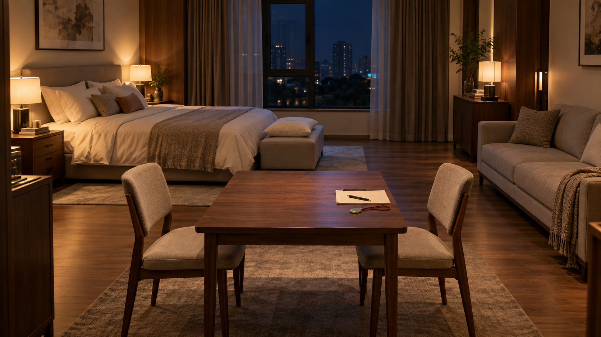
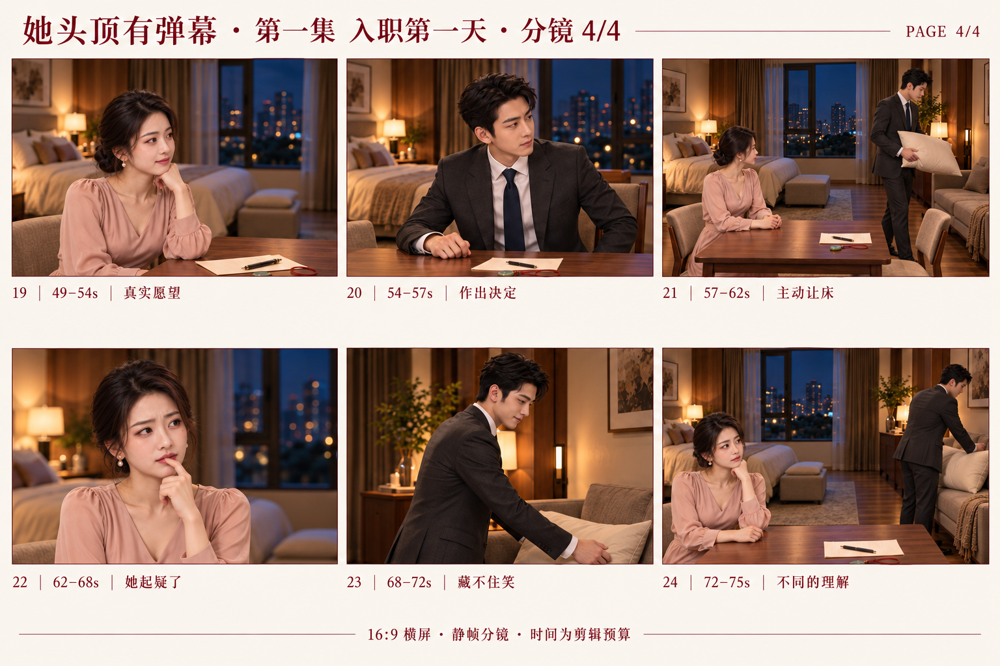

# 《她头顶有弹幕》第一集横屏分镜

《入职第一天》｜分镜 v1.0｜2026-10-14

依据：第二稿 v2.2、用户已确认的男女主定妆提案 A，以及本轮确认的“24 镜头／约 75 秒／16:9 手机横屏”。

本轮交付为婚房场景参考、四张六格静帧分镜板、逐镜头拍摄说明与镜头数据。图中每格是一个镜头的代表性关键帧；动作过程、正式弹幕和配音会在后续阶段完成。时长是剪辑预算，尚未经过配音实测。

## 一、拍摄规格与阅读方法

- 成片：16:9 横屏，目标 1920×1080，25 fps。
- 时长：24 个镜头，预算合计 75 秒，正式剪辑按配音、动作和阅读速度微调。
- 时间码：以秒表示的粗剪预算；0.5 秒精度的估算在最终剪辑时需对齐 25 fps 的整帧边界。
- 顺序：已完成的人物定妆 → 当前静帧分镜与后续画面样片 → 配音试读和节奏校准。
- 分镜板：每页三列、两行，按从左到右、从上到下阅读。成片按16:9设计；当前生成拼版中的画格比例仍有偏差，独立关键帧须重新构图为1920×1080，不能直接拉伸拼版图片。
- 图示与文字的分工：分镜图说明脸、景别、光线与构图；动作、台词、弹幕出现时机及道具状态，以逐镜头表为准。

## 二、婚房与角色连续性

### 固定空间

从入口向室内看：床在左后方，夜间窗户在后方中央，双人沙发沿右墙摆放，胡桃木桌位于中前景。女主坐桌子左端，男主坐右端，两人面对面。床尾凳放备用白枕，男主后半段把它拿到右侧沙发。

对话机位尽量保持在同一侧：女主看向画面右，男主看向画面左。单人近景的背景可以虚化，但不能因此把床、窗、沙发颠倒。结束时女主留在桌边，男主到沙发旁，两人没有重新对视。

### 固定人物与灯光

温书窈沿用 W01：藕粉丝绸长袖裙、低盘发、珍珠耳坠，保持已选脸型、眼睛、发际线与辅助识别点。沈既白沿用 S01：深灰西装、白衬衫、藏蓝领带与短黑发。本集内不换装。

灯光为暖色室内灯与很轻的窗外冷色填充，始终是夜晚。演员的皮肤与脸型参考优先级高于某张分镜图中的局部生成差异。

### 道具状态

- 生活约定：一页浅色纸。正文不依赖生成图里的文字，正式画面只需后期补出短标题“婚后生活约定”。
- 黑笔：男主使用同一支，避免同镜头出现多支相同笔的连续性错误。
- 玉佩：小型浅青玉坠、旧红绳。镜头 01 微亮一次；镜头 09 移到纸左上方桌面，之后不再发光，也不妨碍翻纸。
- 白枕：镜头 21 从床尾凳拿走；镜头 23 放到沙发；结束时不能又出现在凳上。床上的正常枕头与床品保留。
- 场景参考图用于固定空间与风格，细小道具的数量和位置在正式出片时按以上清单统一。

## 三、四张六格分镜板

### 分镜板 1｜镜头 01–06｜0–11 秒

作用：在四秒左右进入第一条反差心声，随后用男主眼神和女主闭嘴的特写建立能力。

### 分镜板 2｜镜头 07–12｜11–29 秒

作用：男主核实异常，尝试继续谈规则，却收到第一轮现场差评。

### 分镜板 3｜镜头 13–18｜29–49 秒

作用：男主把门禁改成报备，让女主重新评价他，再把决定权交给她。

### 分镜板 4｜镜头 19–24｜49–75 秒

作用：男主看到她真实的愿望并让床，女主起疑，他独自藏笑，以双方不同的理解结束。

## 四、镜头时间总表

| 镜号 | 时间 | 时长 | 景别 | 主要内容 |
| --- | --- | --- | --- | --- |
| 01 | 0–1 秒 | 1 秒 | 桌面特写 | 玉佩触发 |
| 02 | 1–3 秒 | 2 秒 | 双人中景 | 婚后约定 |
| 03 | 3–4 秒 | 1 秒 | 女主中近景 | 礼貌回应 |
| 04 | 4–8 秒 | 4 秒 | 女主近景／男主视角 | 首次弹幕 |
| 05 | 8–9.5 秒 | 1.5 秒 | 男主眼部特写 | 异常视线 |
| 06 | 9.5–11 秒 | 1.5 秒 | 女主嘴部特写 | 确认未开口 |
| 07 | 11–13 秒 | 2 秒 | 男主近景 | 他在确认 |
| 08 | 13–18 秒 | 5 秒 | 女主近景 | 礼貌与吐槽 |
| 09 | 18–20 秒 | 2 秒 | 玉佩与手部特写 | 恢复镇定 |
| 10 | 20–23 秒 | 3 秒 | 男主中近景 | 规则开头 |
| 11 | 23–27.5 秒 | 4.5 秒 | 女主近景 | 现场差评 |
| 12 | 27.5–29 秒 | 1.5 秒 | 男主反应近景 | 临场改口 |
| 13 | 29–33 秒 | 4 秒 | 男主中近景 | 改成报备 |
| 14 | 33–37 秒 | 4 秒 | 女主中近景 | 意外停顿 |
| 15 | 37–41 秒 | 4 秒 | 女主近景 | 重新打分 |
| 16 | 41–44 秒 | 3 秒 | 文件与手部特写 | 翻面重写 |
| 17 | 44–47 秒 | 3 秒 | 男主近景 | 征求意见 |
| 18 | 47–49 秒 | 2 秒 | 女主中近景 | 表面随和 |
| 19 | 49–54 秒 | 5 秒 | 女主近景／男主视角 | 真实愿望 |
| 20 | 54–57 秒 | 3 秒 | 男主中近景 | 作出决定 |
| 21 | 57–62 秒 | 5 秒 | 双人全景 | 主动让床 |
| 22 | 62–68 秒 | 6 秒 | 女主近景 | 她起疑了 |
| 23 | 68–72 秒 | 4 秒 | 男主沙发旁侧近景 | 藏不住笑 |
| 24 | 72–75 秒 | 3 秒 | 双人关系中全景 | 不同的理解 |

## 五、逐镜头制作说明

### 镜头 01｜0–1 秒｜玉佩触发

景别与角度：桌面特写；前侧略俯，男主手从画面右侧进入。

画面动作：男主把生活约定推过去，手腕轻触玉佩。玉面只闪一次微光。

公开对白：沈既白：婚后……

心声／弹幕：无新增。

声音与节拍：纸张摩擦；极轻的玉佩提示音。

镜头运动：固定机位，动作由右向左。

剪辑衔接：男主声音跨切到02。

连续性：玉佩在纸张右侧靠男主处；别把玉佩变成发光球。

### 镜头 02｜1–3 秒｜婚后约定

景别与角度：双人中景；主机位正对桌子，女左男右。

画面动作：女主左侧端坐，男主右侧像开会一样认真，两人面对面。

公开对白：沈既白：我有三条要求。

心声／弹幕：无新增。

声音与节拍：延续室内底噪，音乐轻进入。

镜头运动：固定，让姿态反差先成立。

剪辑衔接：随女主准备回答切03。

连续性：建立女看右、男看左；左后床、右后沙发。

### 镜头 03｜3–4 秒｜礼貌回应

景别与角度：女主中近景；正面偏三分之四，视线向画面右。

画面动作：女主轻轻点头，给出标准营业微笑。

公开对白：温书窈：您说。

心声／弹幕：无新增。

声音与节拍：公开声音平稳礼貌。

镜头运动：固定，保留头顶空位。

剪辑衔接：切到稍近的男主主观视角04。

连续性：她的嘴仅在公开对白时动。

### 镜头 04｜4–8 秒｜首次弹幕

景别与角度：女主近景／男主视角；比03略靠近，女主仍看画面右侧的男主。

画面动作：女主嘴闭着，表情得体；弹幕从她头顶附近出现。

公开对白：无。

心声／弹幕：【来了，结个婚还要岗前培训。】

声音与节拍：心声与公开对白错开；首次弹幕轻提示。

镜头运动：轻微推近，给文字留清楚位置。

剪辑衔接：弹幕读完，按男主的视线切05。

连续性：画面底片不烘焙文字；头顶留约15%空间。

### 镜头 05｜8–9.5 秒｜异常视线

景别与角度：男主眼部特写；同侧轴线，视线从女主眼睛移向她头顶。

画面动作：瞳孔轻轻上移，眉毛微动，第一次短暂停住。

公开对白：无。

心声／弹幕：无新增。

声音与节拍：音乐短暂收轻，保留呼吸。

镜头运动：固定，动作幅度小。

剪辑衔接：视线匹配切06，核实她没有说话。

连续性：不瞪大眼，不把惊讶演成恐惧。

### 镜头 06｜9.5–11 秒｜确认未开口

景别与角度：女主嘴部特写；从眼神匹配切入，保持同一侧脸方向。

画面动作：她的嘴闭着，只有极浅的礼貌笑。

公开对白：无。

心声／弹幕：无新增。

声音与节拍：短暂安静，让观众自行理解。

镜头运动：固定。

剪辑衔接：切男主问句07。

连续性：这镜只证明她未开口，不出现新弹幕。

### 镜头 07｜11–13 秒｜他在确认

景别与角度：男主近景；从女主侧看男主，目光向左。

画面动作：他看回她的眼睛，认真确认刚才发生的事。

公开对白：沈既白：你刚说什么？

心声／弹幕：无新增。

声音与节拍：语气是疑惑，不是责问。

镜头运动：固定。

剪辑衔接：问句结束切08。

连续性：男主仍坐右侧，西装、领带与发型不变。

### 镜头 08｜13–18 秒｜礼貌与吐槽

景别与角度：女主近景；回到女主，目光向右。

画面动作：她先回答，再用一点点眼神变化表示困惑；随后出现第二条心声。

公开对白：温书窈：您说。

心声／弹幕：【年纪轻轻，听力先退休了？】

声音与节拍：先对白，停半拍，再心声。

镜头运动：固定，不为两段声音增加无意义摇镜。

剪辑衔接：男主试图恢复秩序，切手部09。

连续性：心声时嘴保持闭合；两种声音仍属于同一位女演员。

### 镜头 09｜18–20 秒｜恢复镇定

景别与角度：玉佩与手部特写；与01同侧的桌面插入镜头。

画面动作：他把玉佩移到纸张左上方的桌面，重新拿起笔。

公开对白：无。

心声／弹幕：无新增。

声音与节拍：轻放玉佩声、拿笔声。

镜头运动：固定。

剪辑衔接：手的动作带出男主继续念条款10。

连续性：分镜调度微调：玉佩放在纸旁，避免16翻纸被压住；之后不再发光。

### 镜头 10｜20–23 秒｜规则开头

景别与角度：男主中近景；男右女左轴线不变。

画面动作：他看一眼条款，抬眼继续，努力像什么都没发生。

公开对白：沈既白：第一，每晚十点前——

心声／弹幕：无新增。

声音与节拍：使用平常工作口吻。

镜头运动：固定，留出半句未完的停顿。

剪辑衔接：未说完时切女主心声11。

连续性：笔在男主右手；玉佩已经在纸旁。

### 镜头 11｜23–27.5 秒｜现场差评

景别与角度：女主近景；男主视角，留头顶字幕区。

画面动作：她仍然礼貌，眼神却开始评估这条规矩，弹幕完成差评。

公开对白：无。

心声／弹幕：【必须回家？还有门禁？扣十分。】

声音与节拍：心声清晰，最后“扣十分”稍重。

镜头运动：固定，以文字节拍产生喜剧。

剪辑衔接：“扣十分”读完切12。

连续性：一条主弹幕，按语意分拍；不要三行同时挤满画面。

### 镜头 12｜27.5–29 秒｜临场改口

景别与角度：男主反应近景；比10略近，不越轴。

画面动作：原本准备接下去的话被他吞回去，视线轻轻停住。

公开对白：无。

心声／弹幕：无新增。

声音与节拍：保留短停顿，音乐可用一个轻顿点。

镜头运动：固定。

剪辑衔接：视线与姿态连续接13。

连续性：笑点是现场改口；不新增夸张肢体动作。

### 镜头 13｜29–33 秒｜改成报备

景别与角度：男主中近景；回到10的机位与视线。

画面动作：他若无其事把规矩改成对自己的要求。

公开对白：沈既白：我会回家。有事提前告诉你。

心声／弹幕：无新增。

声音与节拍：像原本就打算这么说。

镜头运动：固定。

剪辑衔接：说完把反应空间交给女主14。

连续性：头部与12连续；不突然换坐姿或换手。

### 镜头 14｜33–37 秒｜意外停顿

景别与角度：女主中近景；与03接近的机位。

画面动作：她本来准备接受管理，结果听到他报备，点头动作慢半拍。

公开对白：温书窈：您不用跟我报备。

心声／弹幕：无新增。

声音与节拍：语气礼貌里带一点意外。

镜头运动：固定，稍宽以看清身体停顿。

剪辑衔接：转到更近的内心评估15。

连续性：她尚未知道能力，只觉得这个丈夫和预期不同。

### 镜头 15｜37–41 秒｜重新打分

景别与角度：女主近景；男主视角。

画面动作：她重新打量他，营业笑里多了一点真实满意。

公开对白：无。

心声／弹幕：【这哪是领导，优秀员工啊。】

声音与节拍：心声轻快，不用公开笑出声。

镜头运动：极轻推近或固定，避免重复大幅运镜。

剪辑衔接：接男主重写规则的动作16。

连续性：男主此时能看见她，所以能够接收到这条弹幕。

### 镜头 16｜41–44 秒｜翻面重写

景别与角度：文件与手部特写；桌面同侧俯拍。

画面动作：他划掉原条款，把纸翻到空白面，放弃照原计划安排。

公开对白：无。

心声／弹幕：无新增。

声音与节拍：笔划纸声，接清晰翻页声。

镜头运动：固定；图示取翻页的中间状态。

剪辑衔接：纸放平后接17。

连续性：玉佩始终在纸左上方桌面，不能压着待翻的纸；手与笔不增殖。

### 镜头 17｜44–47 秒｜征求意见

景别与角度：男主近景；轻微降低姿态，仍看画面左。

画面动作：他把注意力从纸上移到她，认真等待她的要求。

公开对白：沈既白：你的要求呢？

心声／弹幕：无新增。

声音与节拍：语气比开场更柔和。

镜头运动：固定。

剪辑衔接：按对话节拍切18。

连续性：这个变化由姿态与停顿表现，不额外加深情台词。

### 镜头 18｜47–49 秒｜表面随和

景别与角度：女主中近景；同一对话轴线。

画面动作：她立刻摆出乖巧、没有要求的营业状态。

公开对白：温书窈：我都可以。

心声／弹幕：无新增。

声音与节拍：声音干净、礼貌、轻。

镜头运动：固定。

剪辑衔接：直接转更近的心声画面19。

连续性：公开表情越得体，下一镜心声反差越清楚。

### 镜头 19｜49–54 秒｜真实愿望

景别与角度：女主近景／男主视角；保留头顶干净空间。

画面动作：嘴上无欲无求，心里开始列真实愿望，最后把目光极轻地带向床。

公开对白：无。

心声／弹幕：【不想早起，不想陪笑。床最好归我。】

声音与节拍：按三小句依次读出，不与公开对白重叠。

镜头运动：固定，图示以最后一个愿望为关键帧。

剪辑衔接：通过男主视线接20。

连续性：这是他之后说“床归你”的信息来源。

### 镜头 20｜54–57 秒｜作出决定

景别与角度：男主中近景；从女主侧看，保持桌边位置。

画面动作：他看完心声，视线先向床、再向沙发，决定让出床。

公开对白：无。

心声／弹幕：无新增。

声音与节拍：用小幅视线与呼吸变化完成决定。

镜头运动：固定，以视线指向两处空间。

剪辑衔接：起身动作衔接到21的全景。

连续性：本镜是两次视线动作；静帧只示意作出决定的一刻。

### 镜头 21｜57–62 秒｜主动让床

景别与角度：双人全景；回到02的主机位。

画面动作：他离开右侧椅子，拿床尾凳的备用白枕，走向右侧沙发；女主坐在左侧跟随他的动作。

公开对白：沈既白：床归你。

心声／弹幕：无新增。

声音与节拍：椅子轻响、脚步、布料声；台词轻松落下。

镜头运动：固定或很小的跟随；静帧取抱枕转向沙发的中间状态。

剪辑衔接：按女主惊喜反应切22。

连续性：路径是右椅→床尾凳→右侧沙发；床上被子与其他枕头不消失。

### 镜头 22｜62–68 秒｜她起疑了

景别与角度：女主近景；仍在桌边，视线先跟人再收回。

画面动作：她先高兴，嘴角刚翘起，又意识到不对，指尖轻触自己嘴边。

公开对白：无。

仅观众心声：【等一下。我刚才说出来了？】

声音与节拍：心声由高兴转为小声疑惑。

镜头运动：固定，留足两种表情的变化。

剪辑衔接：镜23与此镜可理解为同一时刻的不同人物反应。

连续性：男主已经背对她，这条心声只给观众，不属于男主读取。

### 镜头 23｜68–72 秒｜藏不住笑

景别与角度：男主沙发旁侧近景；保持沙发在右侧；拍他朝右的侧面。

画面动作：他背对女主放好白枕，想到刚才的互动，终于露出小笑。

公开对白：无。

心声／弹幕：无新增。

声音与节拍：白枕落在沙发的布料声；音乐变柔和。

镜头运动：固定侧面，不绕到会让两人重新对视的位置。

剪辑衔接：接24的双人空间收尾。

连续性：他没有读取22的新心声，笑来自19与自己让床的决定。

### 镜头 24｜72–75 秒｜不同的理解

景别与角度：双人关系中全景；沿主机位同侧取女前男后的构图。

画面动作：女主左前景仍困惑，男主右后方朝沙发带笑，各自保留自己的理解。

公开对白：无。

心声／弹幕：无新增。

声音与节拍：音乐轻收尾，不添加解释性台词。

镜头运动：固定，停在表情最清楚的时刻切黑。

剪辑衔接：结束第一集。

连续性：两人不重新对视；适度景深让前后两人的表情仍可辨认。

## 六、弹幕、声音与表演

### 六条心声的安排

| 镜头 | 心声文字 | 男主能否读取 |
| --- | --- | --- |
| 04 | 来了，结个婚还要岗前培训。 | 能，同场面对她 |
| 08 | 年纪轻轻，听力先退休了？ | 能，同场面对她 |
| 11 | 必须回家？还有门禁？扣十分。 | 能，同场面对她 |
| 15 | 这哪是领导，优秀员工啊。 | 能，同场面对她 |
| 19 | 不想早起，不想陪笑。床最好归我。 | 能，同场面对她 |
| 22 | 等一下。我刚才说出来了？ | 不能；他已背对她，此句只给观众 |

### 后期文字原则

弹幕不要直接交给底片生成模型写入，避免文字错误、贴脸或后续无法改时长。镜头 04、08、11、15、19 要给头顶或侧上方预留位置；正式对白字幕使用下方安全区，不遮挡嘴部和手部笑点。

同一时刻只突出一条主弹幕。长心声按语意分两到三拍出现；出现公开对白时，先保证对白能听清，再进入内心吐槽。镜头 22 可以沿用女主的心声声音，但不能再剪一个男主“看见新字”的反应。

### 三个必须兑现的反应

第一处：04 的岗前培训弹幕出现，05–07 必须让观众明白他真的看见了。

第二处：11 的“扣十分”落下后，12 的短停顿与13 的改口形成完整笑点。不要提前播放13 的声音破坏期待。

第三处：19 的床位愿望，21 用真实行动兑现。22 的疑惑与23 的笑必须保留差异，24 不用额外台词解释。

## 七、从静帧到后续画面样片

### 需要补充起止状态的镜头

镜头 01：纸尚未推动、玉佩尚未触碰 → 玉佩微亮。可通过轻微手部动作和后期光效完成，不让玉佩持续发光。

镜头 09：玉佩仍在纸右侧 → 已移到纸左上方桌面并拿笔。只保留一次清楚的道具移动。

镜头 16：条款尚未划去 → 已划去并翻到空白面。必要时分两段动作素材制作，最终按镜头表衔接。

镜头 21：坐在右侧椅子 → 到床尾凳拿枕 → 抱枕转向沙发。当前板图只示意抱枕转向的中间状态，不能拿一张图宣称全过程已生成。

镜头 22：小小得意 → 意识到不对 → 指尖碰嘴。先保证脸与表情稳定，再加手部动作。

镜头 23：抱枕靠近沙发 → 放好枕头 → 忍不住笑。镜头 24 沿用枕头已经在沙发上的状态。

### 进入视频制作时的检查

- 同一角色的脸、发型、服装与配饰在连续镜头中是否稳定。
- 正反打是否保持女看右、男看左，眼神高度能否接上。
- 玉佩、笔、纸和枕头的位置是否遵守状态表。
- 弹幕是否留得下、读得完，公开对白和心声是否互相争抢。
- 放大到目标画面后，手部、脸部和道具是否需要重新生成对应镜头。
- 是否真正完成动作与反应，而不只是对静帧做缩放。

## 八、资产与完成范围

本轮文件包括 SC01 婚房场景图、SB01–SB04 四张分镜板、本 Word/Markdown 分镜文稿、CSV 镜头表、JSON 镜头数据、生成提示词及资产清单。分镜板用于审阅和指导，正式制作时应按所选镜头生成或整理独立关键帧，不直接把整页联络表当成视频。

目视校对记录：镜头05的示意眼神仍偏向画面右，正式关键帧应改为向左上；镜头16的玉坠孔型与01不一致，应统一为01的小型实心椭圆玉坠；镜头22、24的床尾凳仍残留枕头示意，正式关键帧应清空；部分男主近景的床景背景与主机位不一致，应改为右侧沙发方向的虚化背景。以上均以逐镜头说明为执行依据，已记录为独立关键帧阶段的修正项。

使用 image_gen.imagegen 生成图像；具体模型版本与随机种子未由工具返回，因此不填写虚构参数。所有原始生成图保留，仓库中的图像采用原样复制。提示词记录了男女主与婚房参考图的关系。

当前交付不包含连续动作视频、正式配音、口型同步或成片。75 秒是已核对相加的镜头预算，并非实测视频时长。

同步修订：剧本文稿更新至 v2.2，改用16:9横屏、第一集24镜头75秒预算；将玉佩放置与最后一条仅观众心声的文字说明对齐本分镜。定妆说明也同步更新横屏要求，人物形象保持提案 A。
